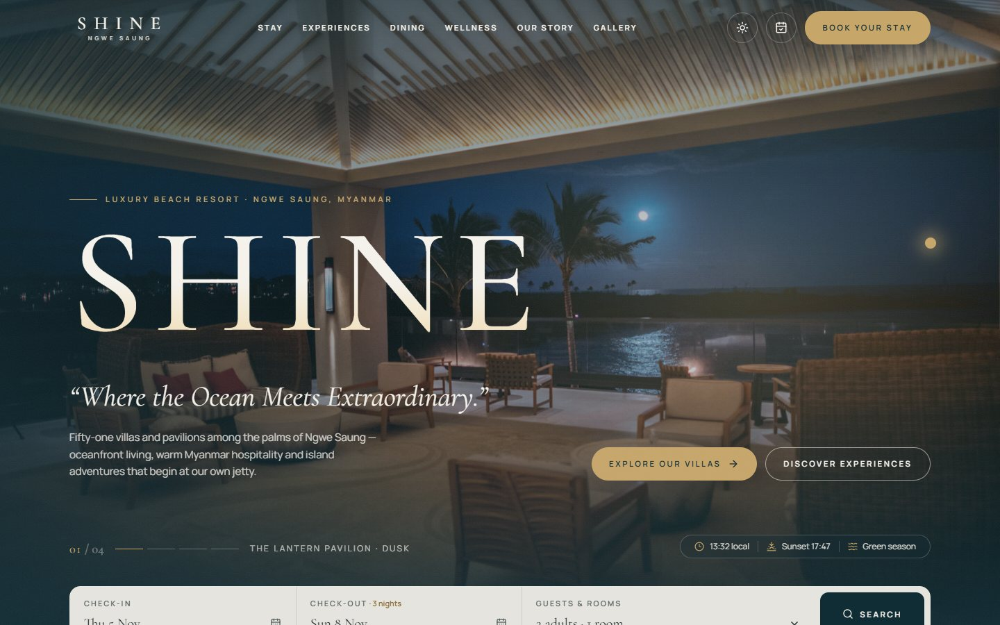
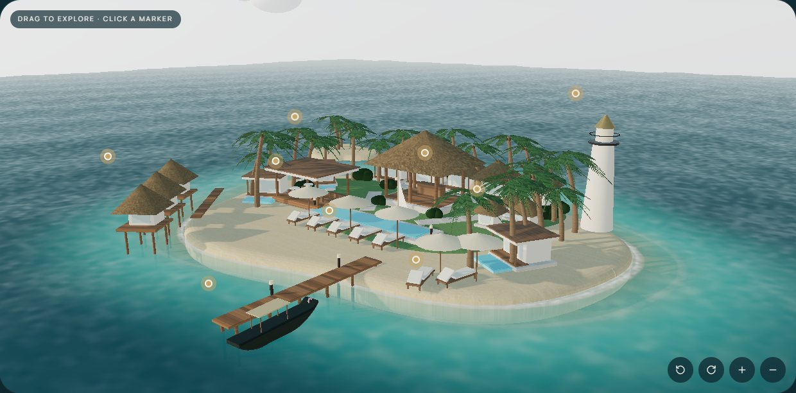
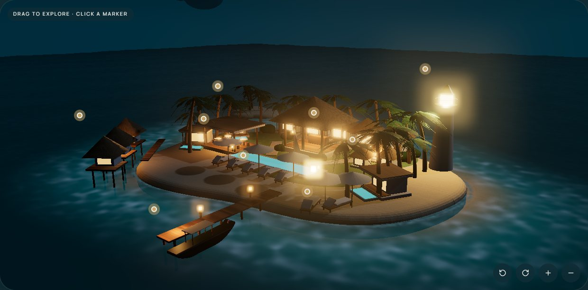
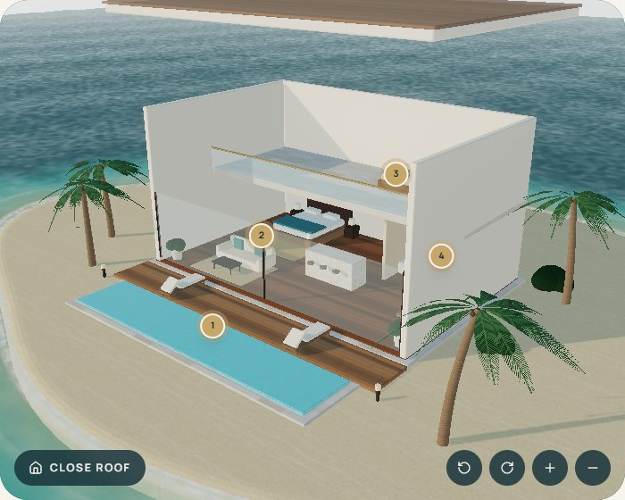
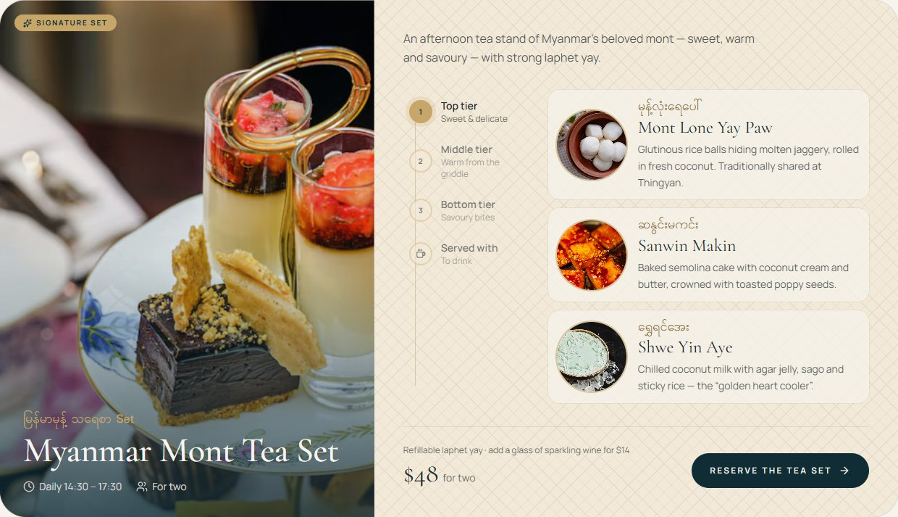
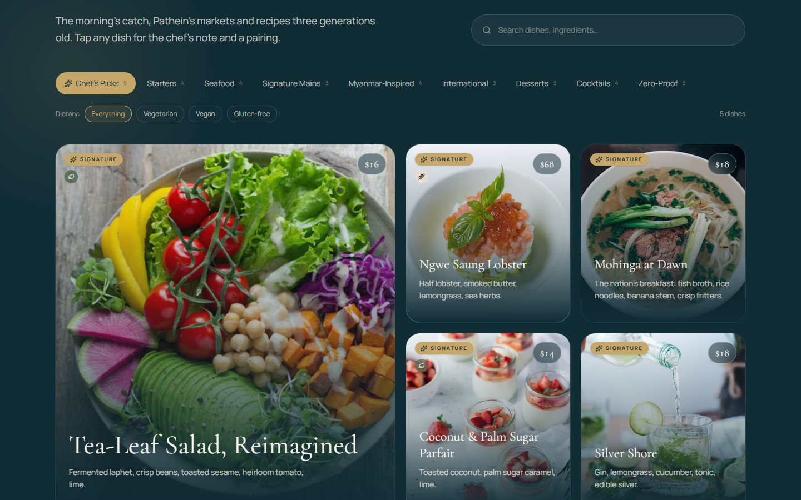
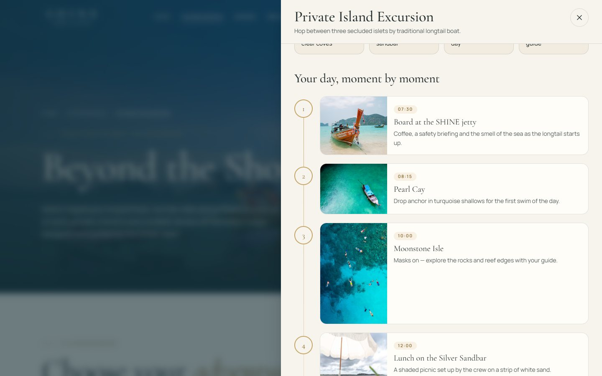
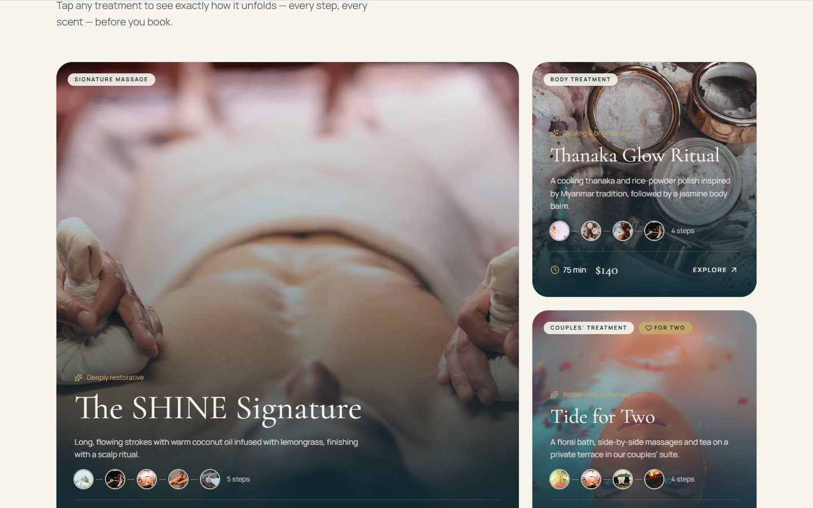
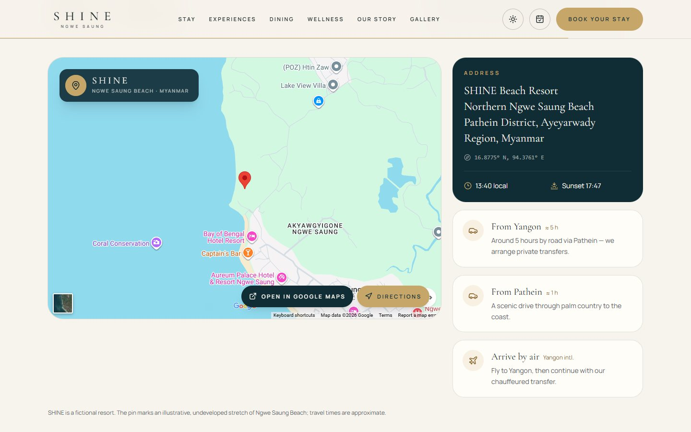

# SHINE — Luxury Beach Resort & Island Escape

**Live demo → https://dev-by-humblekids.github.io/ShineResort/**

<a href="https://dev-by-humblekids.github.io/ShineResort/">
  
</a>

> *“Where the Ocean Meets Extraordinary.”*
> Stay by the sea. Discover beyond the shore.

A frontend portfolio project: the website of **SHINE**, a **fictional** five-star beachfront resort in Ngwe Saung, Myanmar. It combines editorial luxury-hospitality design, cinematic motion, two hand-built 3D scenes and a complete (simulated) booking experience for rooms, island adventures, dining and spa.

> ⚠️ **SHINE does not exist.** Its history, founders, rooms, prices, availability, menus, reviews and awards are invented demonstration content. No real booking, payment or email is ever made.

---

## Screenshots

<table>
  <tr>
    <td width="50%"></td>
    <td width="50%"></td>
  </tr>
  <tr>
    <td>3D resort island — drag to explore, tap a marker to open that place</td>
    <td>The same island at night: lanterns, lit windows and the lighthouse beacon</td>
  </tr>
  <tr>
    <td width="50%"></td>
    <td width="50%"></td>
  </tr>
  <tr>
    <td>Cut-away 3D villa with numbered hotspots linked to photography</td>
    <td>Myanmar mont tea set — explore each tier of the stand</td>
  </tr>
  <tr>
    <td width="50%"></td>
    <td width="50%"></td>
  </tr>
  <tr>
    <td>Menu explorer — photo cards, search, dietary filters and pairings</td>
    <td>Every experience shows your day, moment by moment, before you book</td>
  </tr>
  <tr>
    <td width="50%"></td>
    <td width="50%"></td>
  </tr>
  <tr>
    <td>Spa treatments as photo journeys, step by step</td>
    <td>“Getting here” — Google Map pin on Ngwe Saung Beach, directions and travel times</td>
  </tr>
</table>

## Highlights

| Area | What it shows |
| --- | --- |
| **Opening & transitions** | Once-per-visit lantern intro, a midnight “tide” curtain between pages, blur-up image loading, scroll-progress line |
| **Cinematic hero** | Crossfading 4-slide slideshow with Ken Burns, golden glare, pause control, live Ngwe Saung local time and today’s sunset (computed with the NOAA solar equations) |
| **Micro-interactions** | Magnifying-glass cursor with contextual labels (View / Drag / Explore), magnetic CTAs, 3D tilt cards with image swap, count-up stats, marquee, animated wave edges |
| **3D Resort Island** | Three.js model of the whole property — physically-based sky, custom ocean shader (waves, fresnel reflections, sun glint, clear shallows, rolling surf), procedural sand / timber / thatch textures, curved palms, bloom-lit lanterns at night; drag to orbit, glowing markers link to villas, dining, spa, jetty, horse riding and *Pearl Cay* |
| **3D “dollhouse” villas** | Every room type is generated from data as a cut-away model (roof lifts, stilts over the lagoon, private pools, two storeys) with numbered hotspots linked to real photography — loaded only on demand |
| **Day ↔ Night** | One toggle switches the whole site *and* the 3D lighting from sunlit shore to lantern-lit night (stars, glowing windows, lighthouse beacon) |
| **Stay search & availability** | Custom two-month range calendar with nightly “from” prices and presets, date / guest / room validation, deterministic demo inventory, *Available · Limited · Sold Out · Request Required* states, season & weekend pricing, filters and sorting |
| **Room booking flow** | 5 steps — dates → room → extras → guest details → review — with an itemised, transparent price summary and a generated booking reference |
| **Beyond the Shore** | 13 bookable experiences (island excursion, boat charter, beach horse riding, sunset cruise, snorkelling…) — each with highlights, a photo timeline of the day and package comparison cards; filters, add-ons, participant limits, weather notes, *instant vs. concierge* confirmation and an “Explore first” shortcut |
| **Dining** | Four venues, 8 curated menu sets (led by a Myanmar *mont* tea stand with Myanmar-script names), a photo-card menu explorer with search, dietary filters, chef’s notes and pairings, and table reservations that pre-fill from a chosen set |
| **Lumina Spa** | Treatments as photo journeys — every step, ingredients and who it suits — with an appointment form |
| **Getting here** | Google Map pinned on an undeveloped stretch of Ngwe Saung Beach, directions, live local time and sunset |
| **Our Story** | Scroll-driven word reveal, sticky timeline 1968 → today, values, interactive SVG site plan + architectural gallery |
| **Gallery** | Filterable masonry with an accessible lightbox (← → Esc) |
| **My Reservations** | Look up a booking by reference + last name; status timeline; guest data hidden from the device list |

## Tech stack

- **React 19 + TypeScript + Vite 6**
- **Tailwind CSS v4** with brand design tokens (`src/index.css`)
- **Framer Motion** — reveals, masks, page & layout transitions (respects *reduced motion*)
- **Three.js** — custom render-on-demand stage, pauses off-screen (`src/three/`)
- **Lenis** smooth scrolling (disabled for reduced motion)
- **React Router** (`HashRouter` so deep links work on GitHub Pages)
- **lucide-react** icons · Google Fonts *Cormorant Garamond* + *Manrope*

No backend: demo reservations are stored in the visitor’s `localStorage`.

## Getting started

```bash
npm install
npm run dev        # http://localhost:5173
npm run build      # type-check + production build in dist/
npm run preview    # serve the production build
```

Requires Node 18+.

### Deploy to GitHub Pages

Every push to `main` is built and published by `.github/workflows/deploy.yml`. The build uses relative asset paths (`base: './'`) and hash routing, so it works under any Pages sub-path.

## Project structure

```
src/
  data/          rooms, experiences, dining, spa, packages, story, gallery, images (typed mock data)
  lib/           availability engine, pricing & fees, dates, reservations store, smooth scroll
  context/       Day/Night theme, shared stay search
  three/         stage (renderer, lights, hotspots, on-demand loop), island + villa builders
  components/    layout, booking forms, room cards, UI primitives (modal, lightbox, tilt card…)
  pages/         Home, Stay, RoomDetail, Experiences, Dining, Wellness, Story, Gallery, Book, Reservations
```

## Design system

| Token | Hex | Use |
| --- | --- | --- |
| Ocean Midnight | `#102C35` | premium / immersive sections |
| Deep Teal | `#164B50` | ocean adventures |
| Lagoon Blue | `#4D8990` | “request” states, accents |
| Champagne Gold | `#C7A66A` | restrained highlights, CTAs |
| Pearl White | `#F7F4ED` | editorial background |
| Warm Sand | `#E9DDC9` | secondary surfaces |
| Palm Green | `#536C55` | “available”, nature |
| Charcoal | `#202A2B` | body text |

Headlines use an elegant serif; UI and body copy use a modern sans-serif with spaced uppercase labels.

## Accessibility & performance

- Semantic landmarks, skip link, labelled forms with inline errors and focus on the first invalid field
- Focus-trapped dialogs and lightbox with Escape/arrow keys and focus restore
- Status badges combine icon + text (never colour alone)
- `prefers-reduced-motion` disables smooth scroll, parallax loops and water animation
- Responsive Unsplash images (`srcset`/`sizes`), lazy loading, route-level code splitting
- Three.js (~130 kB gzip) is only downloaded when a 3D scene is about to appear; scenes render only while visible
- On touch devices the 3D scenes don’t hijack page scrolling — rotation uses on-screen buttons

## Testing performed

Manual checks in a Chromium preview during development:

- `tsc -b` and `vite build` pass with no errors
- No horizontal overflow on any route at 375 px width
- Room booking flow end-to-end: validation errors, price calculation (verified by hand), terms checkbox, reference generation
- Reservation lookup (wrong / right last name), status timeline, guest names absent from device list
- Experience filters, package / participant / add-on pricing, validation and confirmation
- Menu tabs and dietary filters, table reservation, spa booking pre-selection
- Gallery filter + lightbox keyboard navigation
- 3D island and villa scenes in both day and night themes; no console errors

Not tested: Safari/Firefox, real mobile hardware, screen-reader walkthroughs.

## Credits

- Photography: [Unsplash](https://unsplash.com) (Unsplash License), used illustratively for a fictional brand
- Design & development: **KoonSett (Win Thant Aung)** — [Dev-By-HumbleKids](https://github.com/Dev-By-HumbleKids)

## License

MIT for the code. Photos remain under their respective Unsplash licenses.
